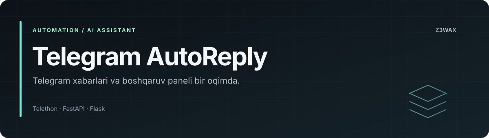

<!-- z3wax:presentation:start -->


[Loyiha xaritasi va misol](docs/PROJECT_GUIDE.md) · [Roadmap](ROADMAP.md) · [Baholash](docs/EVALUATION.md) · [Changelog](CHANGELOG.md) · [Relizlar](docs/RELEASING.md)

[](https://github.com/z3wax/moonlight/actions/workflows/documentation.yml)

**Tekshiruvlar:** [Documentation workflow](https://github.com/z3wax/moonlight/actions/workflows/documentation.yml) · Mavjud workflowlar: [deploy-hf-space.yml](https://github.com/z3wax/moonlight/actions/workflows/deploy-hf-space.yml)

Hujjatlar CI holati dastur yoki model testlari holatidan alohida.
<!-- z3wax:presentation:end -->

# Telegram AutoReply + Admin panel

Telegram akkauntingizni avtomatlashtiradi: siz yo'q paytda sizga yozganlarga
**OpenRouter** orqali AI javob beradi. Barcha sozlamalar **admin panel**da
(iPhone uslubidagi yoqish/o'chirish tugmalari bilan), `.env` faqat boshlang'ich
maxfiy kalitlar uchun.

## Imkoniyatlar

**AI javoblar**
- Bir nechta OpenRouter API kaliti — biri limitga yetsa yoki ishlamasa, keyingisi
  sezdirmasdan ishga tushadi; panelda har bir kalit holati ko'rinadi
- OpenRouter kalitlari va modellari tugasa — **MoonLight API** (oxirgi chora,
  `z3wax/mybackend` dagi MoonLight, `/api/ai/ask`). U ham ishlamasa, odam jim qolmasin deb
  tayyor javob yuboriladi
- Bepul, rasmni ko'radigan model (standart: `google/gemma-3-27b-it:free`) va zaxira modellar
- "Thinking" rejimi o'chirilgan — tez javob
- Rasm yuborilsa AI uni ko'rib javob beradi
- Qarz haqida yozilsa — AI improvizatsiya qilmaydi, tayyor halol javob beradi
  ("men AI yordamchiman, moliyaviy masalalarni hal qila olmayman, egasiga yetkazdim")
  va sizga darhol 🚨 xabar keladi

**Ikkinchi akkauntingiz orqali**
- Kim yozgani va nima haqida ekani qisqacha keladi: *[Yordam so'rayapti]*, *[Taklif]*,
  *[Mijoz bo'lmoqchi]*… (faqat onlayn bo'lsangiz — sozlanadi)
- Rasm yuborishsa — rasmning o'zi va uning tahlili keladi
- Har 5 soatda hisobot (oraliq sozlanadi)
- Boshqaruv: `/name Ism Familiya`, rasm + `/photo`, `/ai on|off`, `/report`, `/post`,
  `/time 22:30`, `/channel @kanal`, `/topics` yoki oddiy so'z bilan:
  *"kanalimga har kuni 22:30 da texnologiya va biznes haqida e'lon ber"*.
  Profildan faqat **ism va rasm** o'zgartiriladi.
- Ikkinchi akkaunt raqamli ID bo'yicha qotiriladi — kimdir keyin shu @username'ni
  egallab olsa ham botni boshqara olmaydi

**Kanal**: har kuni belgilangan vaqtda mavzular ro'yxatidan navbatdagisi bo'yicha e'lon.

**Admin panel** (2 sahifa: kirish va boshqaruv)
- Umumiy holat: AI tugmasi, Telegram holati, javoblar, kalitlar, server (xotira, disk, uptime)
- Telegram: panelning o'zidan login (telefon → kod → 2FA), profil ismi/rasmi,
  joriy sessiya ma'lumoti, akkauntdagi **barcha faol sessiyalar** ro'yxati va ularni tugatish,
  **sessiyani bekor qilish**
- Sun'iy intellekt: kalitlarni qo'shish/o'chirish/tartiblash, AI ni sinash
- Xulq-atvor, Shaxsiyat, Ikkinchi akkaunt, Kanal — barcha sozlamalar
- Xavfsizlik: login/parolni o'zgartirish, zaxira holati
- Loglar (API kalitlar loglarda avtomatik yashiriladi)

**Xavfsizlik**
- Parol scrypt xeshi bilan saqlanadi, kodda yo'q
- 5 ta noto'g'ri urinish → IP 15 daqiqaga bloklanadi
- HttpOnly + Secure cookie, CSRF tokeni, Origin tekshiruvi, qattiq CSP va boshqa
  xavfsizlik sarlavhalari; sessiya 12 soat (2 soat harakatsizlikda tugaydi)
- Sessiya kaliti panelda **hech qachon ko'rsatilmaydi**; API kalitlar yashirilgan
- Hugging Face'da holat (sessiya + sozlamalar) **shifrlangan holda** private
  dataset'ga zaxiralanadi — Space qayta ishga tushsa ham sessiya yo'qolmaydi

## Arxitektura

```
Brauzer ──► Vercel (panel: sahifalar + /api proksi) ──► Hugging Face private Space (bot + API)
              HF token va PROXY_SECRET faqat Vercel serverida      faqat PROXY_SECRET bilan kelgan
              cookie'lar Vercel domenida (Safari ham ishlaydi)      so'rovlarga javob beradi
```

- `panel/` — Vercel'ga joylanadigan panel (qora premium dizayn, o'z ikonkalari).
  `panel/api/proxy.js` so'rovlarni HF'ga uzatadi; Vercel env: `HF_SPACE_URL`, `HF_TOKEN`, `PROXY_SECRET`.
- Model: OpenRouter'dagi **istalgan** model — panelda qidiruv va filtrlar
  (bepul / rasm ko'radi / thinking'siz) bilan tanlanadi, yoki ID qo'lda yoziladi.

## Hugging Face'ga joylash (private Space)

1. **HF token**: <https://huggingface.co/settings/tokens> → *New token* → turi **Write**.
2. GitHub'da: `z3wax/moonlight` → *Settings → Secrets and variables → Actions*:
   - **Secrets**: `HF_TOKEN` (1-qadamdagi token), `ADMIN_PASSWORD` (panel paroli),
     `PROXY_SECRET` (Vercel'dagi bilan bir xil qiymat)
   - ixtiyoriy **Variables**: `HF_SPACE` (standart: `ABDULHODIY/tg-autoreply`)
3. *Actions → "Deploy Telegram AutoReply to Hugging Face" → Run workflow*
   (keyin har bir push'da o'zi yangilanadi).

Workflow testlarni o'tkazadi, **private** Space yaratadi, secret'larni qo'yadi
(`SECRET_KEY` bir marta avtomatik yaratiladi), kodni yuklaydi.
Space ochiq bo'lib qolsa, deploy to'xtaydi.

Qo'lda (kompyuterdan) ham mumkin:

```bash
git clone https://github.com/z3wax/moonlight && cd moonlight
pip install huggingface_hub
HF_TOKEN=hf_xxx HF_SPACE=ABDULHODIY/tg-autoreply ADMIN_PASSWORD='...' python deploy/deploy_hf.py
```

4. Space ochilgach panelga kiring → **Telegram akkaunt** bo'limida API ID/Hash
   (<https://my.telegram.org>) kiriting → telefon → kod → tayyor.
5. **Sun'iy intellekt** → OpenRouter kalitlarini qo'shing (<https://openrouter.ai/keys>).
6. **Ikkinchi akkaunt** → `@username` kiriting.

> Panelni Vercel manzilidan oching. `PROXY_SECRET` qo'yilgach HF Space API'si
> faqat Vercel orqali ishlaydi (to'g'ridan-to'g'ri kirish uchun `ALLOW_DIRECT_PANEL=1`).

### Hugging Face cheklovlari (bilib qo'ying)
- Bepul Space **48 soat hech kim ochmasa uxlab qoladi** — bot ham to'xtaydi.
  Panelni vaqti-vaqti bilan ochib turing yoki Space'ga pullik "always on"
  qurilma/persistent storage ulang. Uyg'onganda sessiya zaxiradan tiklanadi va
  o'qilmagan xabarlarga javob beriladi.
- Persistent storage ulansa (`/data`), holat diskda saqlanadi; dataset zaxirasi
  qo'shimcha himoya bo'lib qoladi.

## PythonAnywhere (Flask/WSGI)

Panel Web (WSGI) da, bot Always-on task'da: [PYTHONANYWHERE.md](PYTHONANYWHERE.md).

## O'z kompyuteringiz / VPS'da

```bash
git clone https://github.com/z3wax/moonlight && cd moonlight
python -m venv .venv && source .venv/bin/activate
pip install -r requirements.txt
cp .env.example .env      # ADMIN_PASSWORD va SECRET_KEY ni yozing
python main.py            # panel: http://localhost:7860
# yoki: docker compose up -d --build
```

## Bepul modellar haqida
OpenRouter'da `:free` modellar uchun kunlik limit bor (kredit sotib olinmagan
akkauntda kuniga ~50 so'rov, ≥10$ kredit bilan ~1000). Shuning uchun bir nechta
kalit qo'shish foydali. Har bir kalit **o'zingizga tegishli** bo'lsin — limitni
aylanib o'tish uchun ko'p akkaunt ochish OpenRouter qoidalariga zid va hammasi
bloklanishi mumkin. Model nomlari vaqt o'tib o'zgarishi mumkin — ro'yxat:
<https://openrouter.ai/models?q=free>, panelda istalgan vaqtda almashtiriladi.

## Muhim
- Bitta Telegram sessiyani **bir vaqtda ikki joyda** ishga tushirmang (masalan HF va
  kompyuter) — Telegram ikkalasini ham o'chiradi.
- Userbot'lar ruxsat etilgan, lekin spam/ommaviy xabar akkauntni bloklaydi.
  Bot faqat sizga yozganlarga javob beradi.
- Bot "AI yordamchi" ekanini yashirmaydi: birinchi xabarda ogohlantiradi (o'chirish mumkin)
  va "botmisan?" deb so'rashsa rost aytadi.
- `SECRET_KEY` ni o'zgartirmang — eski zaxira ochilmay qoladi.

## Tuzilma
```
main.py                 bot + FastAPI panel (bitta jarayon)
flask_app.py            WSGI panel (Flask) - PythonAnywhere Web
worker.py               faqat bot - PythonAnywhere Always-on task
login.py                ixtiyoriy: terminal orqali login
autoreply/
  config.py             sozlamalar sxemasi (panel shu yerdan quriladi)
  runner.py             hammasini bog'lash
  service.py            Telegram ulanishi, paneldan login, sessiyalar
  bot.py                javob berish mantiqi
  owner.py              ikkinchi akkaunt: xulosa, hisobot, buyruqlar, kanal
  llm.py                OpenRouter: ko'p kalit + model failover, rasm
  persist.py            shifrlangan zaxira (HF dataset)
  storage.py            SQLite
  web/                  admin panel backend (FastAPI + uvicorn)
deploy/deploy_hf.py     Hugging Face'ga yuklash
```

Testlar: `pip install pytest && pytest -q`


## Repozitoriy bo'yicha qo'llanma

[PythonAnywhere](PYTHONANYWHERE.md) · [Muhit namunasi](.env.example) · [Testlar](tests/)

**Repozitoriy egasi:** [z3wax](https://github.com/z3wax). Mavjud uchinchi tomon muallifligi va litsenziya bildirishnomalari saqlanadi.

O'zgarish yuborish tartibi: [CONTRIBUTING.md](CONTRIBUTING.md).

### Muammoni yuborishda

- Branch va commit SHA, operatsion tizim hamda runtime versiyasini ko'rsating.
- Minimal qayta chiqarish qadamlari, kutilgan natija va amaldagi javobni yozing.
- Token, cookie, parol, sessiya va shaxsiy ma'lumotlarni loglardan olib tashlang.
- Benchmark natijasida qurilma, model/checkpoint, konfiguratsiya va o'lchov usulini kiriting.
