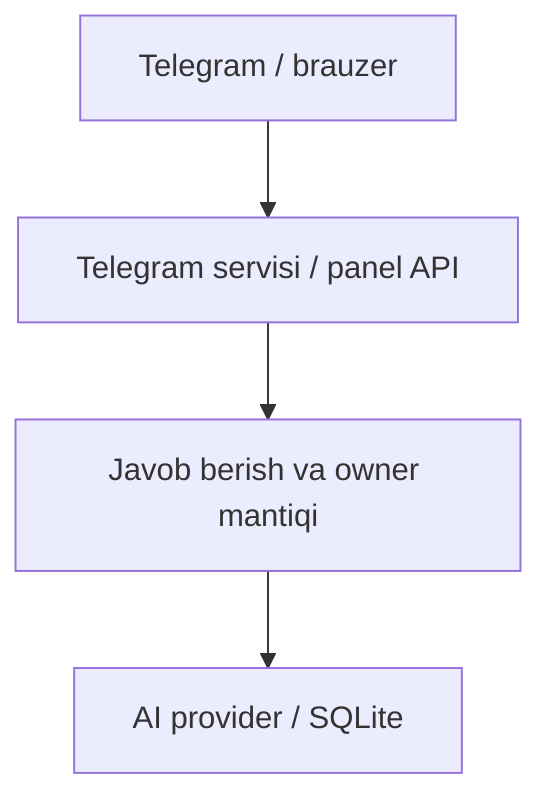

# Telegram AutoReply — loyiha xaritasi

[README](../README.md) · [Roadmap](../ROADMAP.md) · [Baholash](EVALUATION.md) · [Reliz tartibi](RELEASING.md)

## Maqsad

Telegram xabarlari va boshqaruv paneli bir oqimda.

**Texnologiyalar:** Telethon · FastAPI · Flask.

## Arxitektura va oqim

Asosiy oqimning ixcham xaritasi; batafsil xulq manba kodida berilgan.



## Boshlang‘ich misol

Quyidagi buyruqlarni README dagi talablar va sozlash bosqichlaridan keyin, repozitoriy ildizidan bajaring:

```bash
python main.py
```

Avval README bo‘yicha virtual muhit va .env tayyorlang. Botga test akkauntidan ulaning; bitta sessiyani parallel joylarda ishlatmang.

Bu qo‘llanma misolni ushbu hujjat yangilanishi vaqtida bajarilgan test sifatida ko‘rsatmaydi. Test dalili, qurilma va natija baholash hisobotida alohida saqlanadi.

## Manba xaritasi

[main.py](../main.py) · [flask_app.py](../flask_app.py) · [worker.py](../worker.py) · [autoreply/runner.py](../autoreply/runner.py) · [autoreply/llm.py](../autoreply/llm.py) · [PYTHONANYWHERE.md](../PYTHONANYWHERE.md)

## Ish jarayoni

1. Lokal yoki test muhitini tayyorlang.
2. Yuqoridagi eng kichik oqimni tekshiring.
3. Ta’sirlangan modulning testini bajaring.
4. Faqat haqiqiy natijalarni hisobotga kiriting.

[Hissa qo‘shish](../CONTRIBUTING.md) · [O‘zgarishlar](../CHANGELOG.md)
